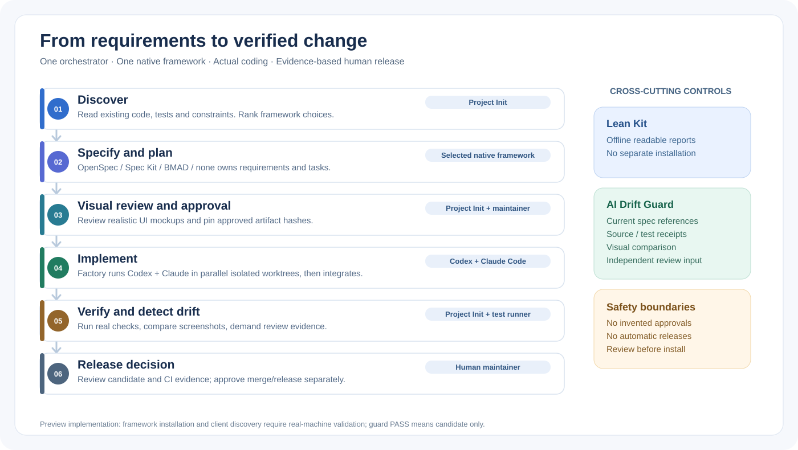
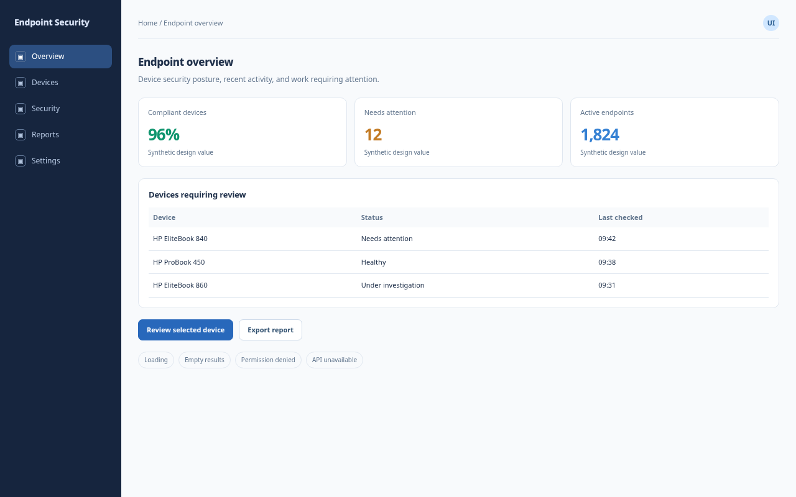
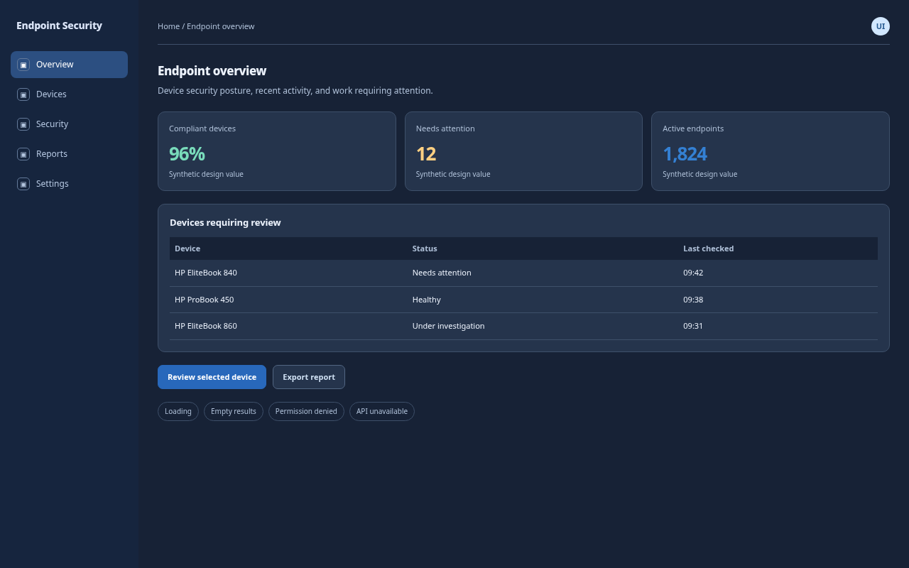
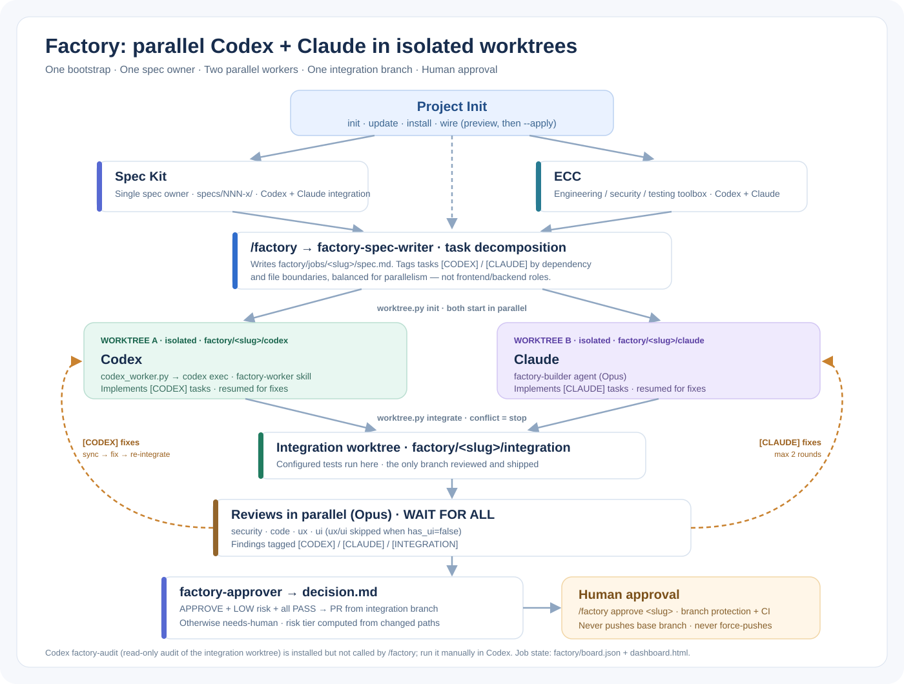

# Project Init

**One entry point for a project. One spec owner. One execution factory. Real evidence.**

[](https://github.com/Thugney/project-init/actions/workflows/ci.yml)
[](docs/RELEASES.md)
[](LICENSE)
[](package.json)

Project Init is a **local-first development workflow orchestrator** for engineers using **Codex** and **Claude Code**. It inspects a new or existing repository, recommends an appropriate planning framework, records approved designs and specifications, and requires test and review evidence before a change is treated as a release candidate.

It does **not** replace your coding agent or run an autonomous developer in the background. The selected framework owns its **native specifications and tasks**; Codex or Claude writes the code. Project Init coordinates and checks the handoffs.

> **Status: `2.1.0-preview.15` — functional preview, not production-accepted.** Automated regression coverage includes feature preparation, isolated Factory evidence, and dashboard states. Live framework installs, real Codex/Claude command discovery, native Claude unattended execution, and Windows browser capture still require workstation acceptance. A passing guard is not proof of full semantic correctness or release approval. See [verification limits](docs/VERIFICATION.md) and the [acceptance report](docs/ACCEPTANCE-REPORT.md).
>
> **Licensing:** Project Init, the bundled Lean Kit, bundled Factory templates, and preserved v1 sources are released under the [Apache License 2.0](LICENSE). External tools such as Spec Kit, ECC, OpenSpec and BMAD are installed separately and keep their own licenses. See [NOTICE](NOTICE.md).

## The problem this solves

AI-assisted development often accumulates multiple PRDs, unapproved UI changes, stale plans, and optimistic “done” reports. Separately installing planning methods and context/rendering tools creates more manual work. Project Init aims to remove these handoffs **without making up implementation evidence**.

| Without a common workflow | What Project Init actually provides today |
| --- | --- |
| You inspect repo setup repeatedly | Read-only discovery and ranked framework suggestions |
| Multiple systems write conflicting specs | One selected framework owns PRD/specs/tasks; Project Init registers authoritative paths |
| Design review is a dense node graph | Offline high-fidelity HTML review with navigation, states and light/dark variants |
| “Done” is based on agent narration | Test receipts, source hashes, bounded execution logs and review requirements |
| UI changes quietly diverge | Configured PNG baseline comparisons and screenshot coverage checks |
| Lean Kit requires a separate setup | Bundled source renderer for reports, diagrams and boards |
| Installed tools look like a prepared feature | Native feature preparation discovers checks, preserves task/requirement IDs and reports pending review/approval separately |
| A dashboard with no jobs looks broken | Valid empty Factory state on apply, actual board location, and distinct missing/invalid/connection states |

## Architecture at a glance



**Responsibility boundaries:**

| Layer | Owner | Output |
| --- | --- | --- |
| Discovery, framework recommendation, installation preview | Project Init | Project assessment, selected framework and version |
| Requirements, architecture decisions, native implementation tasks | **OpenSpec, GitHub Spec Kit, BMAD, or `none`** | Framework-native artifacts (not copied PRDs) |
| Code changes | **Codex** and **Claude Code** in parallel isolated worktrees (Factory) | Real commits on worker branches, merged into one integration branch |
| Design review, drift evidence, acceptance gate | **Project Init** | Approved artifact hashes, actual test runs, screenshot comparisons, requirement findings |
| Report rendering | **Bundled Lean Kit** | Deterministic local HTML reports (not application screens) |
| Final release/merge authorization | **Human maintainer** | Explicit decision under repository protections |

Read [the engineering architecture](docs/ARCHITECTURE.md) and [artifact ownership ADR](docs/adr/0001-single-source-of-truth.md).

## Visual review (synthetic example)

The preview below is rendered from demonstration data, **not a real tenant or verified application**. A real project must supply truthful UI design data and approved reference screenshots.

| Light | Dark |
| --- | --- |
|  |  |

UI projects can define navigation, typography, colors, buttons, tables, component states and responsive variants. The PNG gate compares actual screenshots to approved images at matching dimensions; it **cannot** prove that buttons work, that accessibility is correct, or that a design is semantically correct. Use browser interaction tests for those claims.

## Quick start

**Prerequisites:** Node.js **20.19+**, Git, and an already configured Codex or Claude Code environment for any coding work. Project Init itself has no runtime npm package dependencies. External frameworks are **not** silently installed.

```powershell
# Clone the public source. This is a local install, not an npm registry release.
git clone https://github.com/Thugney/project-init.git
cd project-init
npm ci
npm run test:all
npm install --global .
project-init help
```

Use it on a disposable repository first; do not replace an older Project Init installation without consulting the [migration guide](docs/MIGRATION.md).

### Updating Project Init itself

Starting with preview.7, the global CLI updates independently of any development checkout:

```powershell
project-init update --check
project-init update
```

The updater reads GitHub `main`, pins the exact commit it found, installs that source globally with npm, and verifies the resulting `project-init version`. It does **not** run `git pull` in `C:\Tools\project-init` or require that clone to be clean.

Existing repositories do **not** need a clean working tree just to use Project Init. `init`, Spec Kit preserve-merge, ECC guided setup, and the bundled Factory are designed to coexist with unrelated local work. Project Init must still refuse an actual file collision rather than overwrite user-owned content.

```powershell
cd C:\Work\ExampleRepo

# One entry point: inspect/resume the repo and show the complete Factory bootstrap plan.
project-init init --project .

# Apply the same plan after reviewing it.
project-init init --project . --apply
```

Factory readiness is based on the **actual terminal clients**, not desktop applications. Project Init verifies `codex --version` + `codex login status` and `claude --version` + `claude auth status`. When missing, it offers to install the official Codex CLI (`@openai/codex`) and Claude Code CLI (`@anthropic-ai/claude-code`) through npm, then launches their sign-in flow and verifies authentication before continuing.

The guided apply is an installer, not a prerequisite checklist. When a required bootstrap tool is missing, Project Init asks before installing it, verifies it, and continues to the next stage. For example, Spec Kit's `uv` dependency is installed as a pinned Project Init-managed user tool when approved. On Windows, missing Git/Python prerequisites can also be installed after explicit confirmation. ECC verifies npm/npx before running.

```text
Missing prerequisite -> ask [Y/n]
  Y -> install -> verify -> continue
  N -> STOPPED cleanly; rerun later to resume
```

Use `--yes` only for reviewed non-interactive automation; normal interactive use should keep the per-step confirmations.

The guided Factory bootstrap handles the normal stack for both new and existing repositories:

```text
                 PROJECT INIT
       bootstrap / update / install / wire
                      |
            +---------+---------+
            |                   |
        SPEC KIT               ECC
   (Codex + Claude)      (Codex + Claude)
            |                   |
            +---------+---------+
                      |
                   FACTORY
        factory-spec-writer: task decomposition
     [CODEX] / [CLAUDE] by dependency + file boundaries
                      |
            +---------+---------+
            |                   |
       WORKTREE A          WORKTREE B
        isolated            isolated
   factory/<slug>/codex  factory/<slug>/claude
            |                   |
          CODEX               CLAUDE
     codex_worker.py      factory-builder
     factory-worker            (Opus)
            |                   |
            +---------+---------+
                      |
             INTEGRATION WORKTREE
          factory/<slug>/integration
                      |
          tests + 4 parallel reviewers
       security / code / ux / ui  (Opus)
   findings -> owning worker, max 2 fix rounds
                      |
       factory-approver -> PR from integration
                      |
                human approval
```



### How the Factory works

1. **Decompose.** `/factory` (Claude Code) spawns `factory-spec-writer`, which turns an idea or an approved `specs/NNN-x/` folder into `factory/jobs/<slug>/spec.md`. Tasks are tagged `[CODEX]` or `[CLAUDE]` and balanced across independent, non-overlapping file groups. Codex and Claude are **general workers**: either can own frontend, backend, tests, docs or migrations.
2. **Isolate.** `worktree.py init` creates three Git worktrees from the same base commit: `factory/<slug>/codex`, `factory/<slug>/claude` and `factory/<slug>/integration`. Workers never share a checkout.
3. **Build in parallel.** Codex runs headless through `codex_worker.py` (`codex exec`, using the `factory-worker` skill). Claude runs as the `factory-builder` subagent. Both start in the same stage.
4. **Integrate.** `worktree.py integrate` merges both worker branches into the integration branch. A merge conflict stops the job; neither worker overwrites the other.
5. **Test and review.** Configured tests run in the integration worktree. `security`, `code`, `ux` and `ui` reviewers (all Opus) review the integrated result in parallel; UX/UI are skipped when the job has no UI. The round only completes when every review file exists.
6. **Fix.** Findings tagged `[CODEX]` or `[CLAUDE]` go back to that worker (`worktree.py sync` first, same session resumed). `[INTEGRATION]` findings stop for an explicit resolution plan. Maximum two fix rounds.
7. **Decide.** `factory-approver` writes `decision.md`. Risk tier is computed from changed paths, not by a model. Only APPROVE + LOW risk + all PASS proceeds to a PR from the integration branch; anything else is `needs-human`.
8. **Approve.** A human approves (`/factory approve <slug>`) under branch protection and CI. The Factory never pushes the base branch, force-pushes, or deletes branches.

The Codex `factory-audit` skill is a read-only audit of the integration worktree. It is installed for manual use in Codex and is not called automatically by `/factory`. Job state lives in `factory/board.json` and is shown by `factory/dashboard.html`.

| Component | Installed to | Role |
| --- | --- | --- |
| Claude orchestrator | `.claude/skills/factory/SKILL.md` | Runs the loop, sole writer of `factory/board.json` |
| Claude agents (Opus) | `.claude/agents/factory-*.md` | spec-writer, builder, 4 reviewers, approver |
| Worktree manager | `.claude/skills/factory/scripts/worktree.py` | init / path / sync / integrate / status |
| Codex bridge | `.claude/skills/factory/scripts/codex_worker.py` | Runs `codex exec` per job, logs to files, one-line status |
| Board helper | `.claude/skills/factory/scripts/board.py` | Stages, rounds, verdict collection, risk tier |
| Codex worker | `.agents/skills/factory-worker/SKILL.md` | Implements `[CODEX]` tasks in its worktree |
| Codex audit | `.agents/skills/factory-audit/SKILL.md` | Read-only audit of the integrated result |
| Runtime | `factory/backlog.md`, `factory/dashboard.html` | Queue and live board (jobs are gitignored) |

`inspect`, `recommend`, `select`, `install`, `ecc`, `factory`, and `wire` remain available as advanced/debug controls, but they are not required for the normal Factory bootstrap.

For this factory stack, **Spec Kit is the default** because it natively installs into both Codex and Claude and the factory already consumes `specs/NNN-x/`. BMAD remains an optional alternative for projects that need its deeper product/UX workflow; do not install both planning methodologies for the same change. ECC is a toolbox, not a second spec owner. Factory is the isolated parallel execution/integration/review loop. Start with the [Factory stack cheat sheet](docs/CHEAT-SHEET.md), then see [Factory stack](docs/FACTORY-STACK.md) for boundaries and details.

## Discoverable skills in Codex and Claude Code

Guided `init --apply` installs these project-local skills and updates older versions through a reviewed backup plan. They now use the built-in `prepare` lifecycle before build/verification. Personal installation below remains optional for cross-project command discovery.

```powershell
# For personal skills visible across your local projects (recommended):
project-init wire --project . --agent both --scope user
# If the preview lists old Project Init conflicts, review the backup plan:
project-init wire --project . --agent both --scope user --backup-conflicts
# Only after reviewing the planned backups:
project-init wire --project . --agent both --scope user --backup-conflicts --apply
```

| Workflow | Codex skill | Claude Code skill |
| --- | --- | --- |
| Start/resume | `$project-init` | `/project-init` |
| Design | `$project-init-design` | `/project-init-design` |
| Plan | `$project-init-plan` | `/project-init-plan` |
| Build | `$project-init-build` | `/project-init-build` |
| Verify | `$project-init-verify` | `/project-init-verify` |
| Status | `$project-init-status` | `/project-init-status` |
| Report | `$project-init-report` | `/project-init-report` |

These are **skill instructions**, not seven independent always-running workers. Codex skill discovery is separate from Claude slash command discovery. Claude's optional `/project-init:design` **namespace** requires a plugin loaded explicitly; it is not available from project-local skill files alone. Client UI discovery needs live acceptance testing.

## Verification lifecycle

For existing work, `prepare` selects the actual native feature, reads task progress, discovers supported check commands and prepares requirement mappings **before** baselining. It reuses a valid baseline/approval and reports missing coverage without inventing it. A new worktree receives its own preparation state; a new session receives the feature/task/worktree context. See [feature preparation](docs/FEATURE-PREPARATION.md).

```text
Approve native specification + UI reference screenshots (human)
   -> run bounded implementation through coding agent
   -> execute configured build/tests and capture real receipts
   -> independent source/requirement review + screenshot comparison
   -> Project Init guard: missing or stale evidence BLOCKS
   -> if passing: human release review (not automatic release)
```

Core commands: `project-init prepare`, `baseline`, `review`, `approve`, `verify`, `execution factory`, `execution existing`, `semantic plan`, `semantic import`, `visual plan`, `visual compare`, `source-review`, `guard`, and `status`. See [the complete command reference](docs/COMMANDS.md) and [verification contract](docs/VERIFICATION.md).

- **Semantic guard:** demands a finding for each mapped requirement, current hashed evidence paths and passing configured checks. It **does not automatically infer semantic correctness**; the independent reviewer supplies findings.
- **Visual guard:** compares PNG pixels/viewport sizes and expected theme/state coverage. It does **not** execute click flows unless you configure independent browser interaction tests.
- **Execution:** `project-init run --execute` is a **foreground Codex runner** only. Claude skills guide interactive execution. No daemon, continuous coding, automatic push/merge or deployment is claimed.
- **Factory evidence:** real worker outcomes and Git integration operations are bound to the job's starting baseline, native feature and final integration worktree. Verification uses that integrated source, not a worker's summary. [Evidence workflow](docs/FACTORY-EVIDENCE.md).
- **Existing code:** an explicitly reviewed existing-code mode supports already implemented PRs without a dummy code edit or invented runner history. All current check, source-review, semantic, design and visual gates still apply.
- **CI:** this tool's own CI tests its implementation. Application CI configuration is discovered separately; a workflow file is not a successful run or a required-check rule.
- **Safety:** explicit `--execute` / `--apply` for mutating or executing actions, conflict refusal, local JSONL audit and SHA-256 provenance; local records are **not cryptographic identity signatures**.

Before migrating from an older personal skill, read [the skill installation and migration guide](docs/MIGRATION.md). An agent skill is not installed simply by downloading this repository. Codex personal skills use `$HOME/.agents/skills` and Claude personal skills use `$HOME/.claude/skills`. A Codex Cloud/web environment may require its own configured skill or plugin distribution; do not assume local installation synchronizes with a remote environment.

## Documentation

| For | Read |
| --- | --- |
| New vs existing project, step by step | [Getting started](docs/GETTING-STARTED.md) |
| Start here / daily workflow | [Factory stack cheat sheet](docs/CHEAT-SHEET.md) |
| Installation and platform caveats | [Install](docs/INSTALL.md) |
| All CLI operations | [Commands](docs/COMMANDS.md) |
| Adopt an existing feature and preserve task progress | [Feature preparation](docs/FEATURE-PREPARATION.md), [Check discovery](docs/CHECK-DISCOVERY.md) |
| Factory dashboard and integrated execution evidence | [Dashboard](docs/FACTORY-DASHBOARD.md), [Evidence bridge](docs/FACTORY-EVIDENCE.md) |
| Architecture and ownership | [Architecture](docs/ARCHITECTURE.md), [Factory stack](docs/FACTORY-STACK.md) |
| Threats, guard guarantees and limits | [Security model](docs/SECURITY-MODEL.md) |
| Reproducible checks and acceptance | [Verification](docs/VERIFICATION.md), [Acceptance report](docs/ACCEPTANCE-REPORT.md) |
| Maintainers and release channels | [Releases](docs/RELEASES.md), [Changelog](CHANGELOG.md) |
| Migration from older installations | [Migration](docs/MIGRATION.md) |
| Helping out | [Contributing](CONTRIBUTING.md), [Security policy](SECURITY.md) |

## Community and maintainer

Maintained by **[Thugney](https://github.com/Thugney)**. Practical Microsoft cloud/security writing: **[Eriteach blog](https://blog.eriteach.com/)**. Professional updates: **[LinkedIn](https://www.linkedin.com/in/eriteach/)**. Contributions and technical criticism are welcome—especially reproducible bug reports, adversarial security tests, and Windows/Claude CLI acceptance evidence.

Project Init is an independent community project, **not affiliated with OpenAI, Anthropic, GitHub, ECC, OpenSpec, or BMAD**. Respective names belong to their owners. See [NOTICE](NOTICE.md) for bundled code provenance and the Apache-2.0 attribution.
