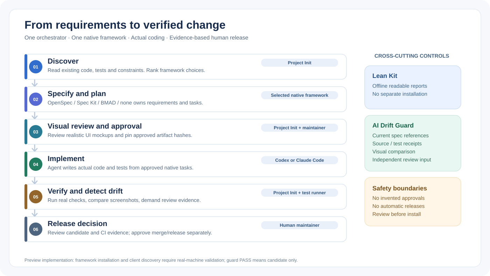
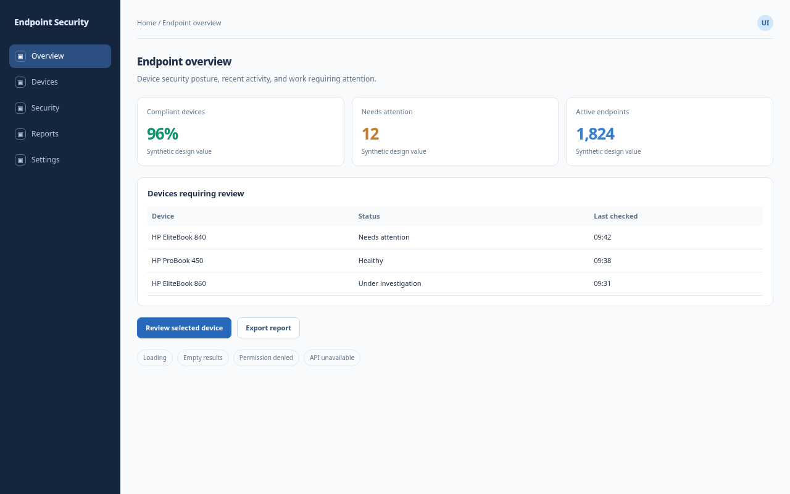
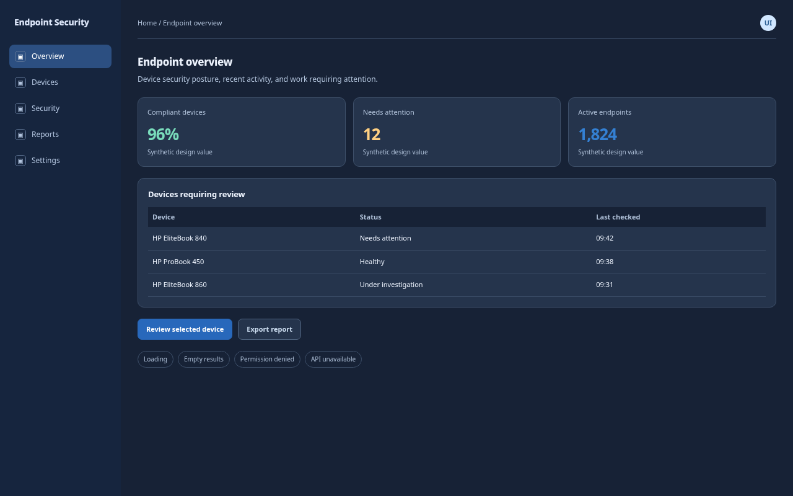

# Project Init

**One entry point for a project. One native spec framework at a time. Real execution evidence—not progress theater.**

[](https://github.com/Thugney/project-init/actions/workflows/ci.yml)
[](docs/RELEASES.md)
[](LICENSE)
[](package.json)

Project Init is a **local-first development workflow orchestrator** for engineers using **Codex** and **Claude Code**. It inspects a new or existing repository, recommends an appropriate planning framework, records approved designs and specifications, and requires test and review evidence before a change is treated as a release candidate.

It does **not** replace your coding agent or run an autonomous developer in the background. The selected framework owns its **native specifications and tasks**; Codex or Claude writes the code. Project Init coordinates and checks the handoffs.

> **Status: `2.1.0-preview.2` — verified end to end with native Codex on Windows.** The tested workflow covers a non-UI project using framework `none`: implementation, functional tests, independent review, candidate acceptance and rejection of stale evidence. All 43 automated tests passed locally. **Claude and live Codex workflows on Linux/macOS have not been tested**; automated CI tests passed on all three operating systems. External framework workflows and UI/browser capture still require live verification. The older npm-installed Codex failed its live attempt; the native Windows executable passed. See the [tested versions, commands and evidence](docs/WINDOWS-ACCEPTANCE-2026-10-20.md). This preview is not yet accepted for production across all supported integrations.
>
> **Licensing:** Project Init, the bundled Codex Lean Kit, and the preserved v1 sources are released under the [Apache License 2.0](LICENSE), as authorized by their maintainer. See [NOTICE](NOTICE.md) for provenance and attribution. GitHub preview source is licensed; **production readiness remains unverified**. npm publishing remains disabled intentionally.

## The problem this solves

AI-assisted development often accumulates multiple PRDs, unapproved UI changes, stale plans, and optimistic “done” reports. Separately installing planning methods and context/rendering tools creates more manual work. Project Init aims to remove these handoffs **without making up implementation evidence**.

| Without a common workflow | What Project Init actually provides today |
| --- | --- |
| You inspect repo setup repeatedly | Read-only discovery and ranked framework suggestions |
| Multiple systems write conflicting specs | One selected framework owns PRD/specs/tasks; Project Init registers authoritative paths |
| Design review is a dense node graph | Offline high-fidelity HTML review with navigation, states and light/dark variants |
| “Done” is based on agent narration | Test receipts, source hashes, bounded execution logs and review requirements |
| UI changes quietly diverge | Configured PNG baseline comparisons and screenshot coverage checks |
| Lean Kit requires a separate setup | Bundled source renderer for reports, diagrams and boards |

## Architecture at a glance



**Responsibility boundaries:**

| Layer | Owner | Output |
| --- | --- | --- |
| Discovery, framework recommendation, installation preview | Project Init | Project assessment, selected framework and version |
| Requirements, architecture decisions, native implementation tasks | **OpenSpec, GitHub Spec Kit, BMAD, or `none`** | Framework-native artifacts (not copied PRDs) |
| Code changes | **Codex** or **Claude Code** | Real commits/diffs and testable application source |
| Design review, drift evidence, acceptance gate | **Project Init** | Approved artifact hashes, actual test runs, screenshot comparisons, requirement findings |
| Report rendering | **Bundled Lean Kit** | Deterministic local HTML reports (not application screens) |
| Final release/merge authorization | **Human maintainer** | Explicit decision under repository protections |

Read [the engineering architecture](docs/ARCHITECTURE.md) and [artifact ownership ADR](docs/adr/0001-single-source-of-truth.md).

## Visual review (synthetic example)

The preview below is rendered from demonstration data, **not a real tenant or verified application**. A real project must supply truthful UI design data and approved reference screenshots.

| Light | Dark |
| --- | --- |
|  |  |

UI projects can define navigation, typography, colors, buttons, tables, component states and responsive variants. The PNG gate compares actual screenshots to approved images at matching dimensions; it **cannot** prove that buttons work, that accessibility is correct, or that a design is semantically correct. Use browser interaction tests for those claims.

## Quick start

**Verified Windows configuration (2026-10-20):** build **26200.9168**, display version **25H2**, x64; PowerShell **7.6.5**, Node **24.12.0**, npm **11.12.1**, Git **2.55.0.windows.5**, native Codex **0.163.0-alpha.10.2**, existing ChatGPT login. `npm run test:all`: **35/35 Project Init + 8/8 Lean Kit**, zero skips; `npm run smoke`: passed. The live disposable addition project passed **3/3 functional tests**, then `guard` returned `readyForHumanReleaseReview: true`, `releaseApproved: false`. This validates that bounded non-UI workflow only; it is not blanket acceptance of every integration. [Reproduction and evidence](docs/WINDOWS-ACCEPTANCE-2026-10-20.md).

**Prerequisites:** Node.js **20.19+**, Git, and an already configured Codex or Claude Code environment for any coding work. Project Init itself has no runtime npm package dependencies. External frameworks are **not** silently installed.

```powershell
# Clone the public source. This is a local install, not an npm registry release.
git clone https://github.com/Thugney/project-init.git
cd project-init
npm ci
npm run test:all
npm install --global .
project-init help
```

Use it on a disposable repository first; do not replace an older Project Init installation without consulting the [migration guide](docs/MIGRATION.md).

```powershell
$project = 'C:\Work\ExampleRepo'
project-init inspect --project $project
project-init recommend --project $project --intent feature --complexity medium
project-init init --project $project --mode Existing --intent feature --ui auto
project-init select --project $project --framework openspec
project-init handoff --project $project --phase planning
```

`recommend` offers alternatives. The user decides; for small projects `none` is valid. Framework selection does **not** automatically download or execute a vendor installer. Use `project-init install` first as a preview, then `--apply` with an explicit version only after checking the proposed steps.

## Discoverable skills in Codex and Claude Code

```powershell
# For personal skills visible across your local projects (recommended):
project-init wire --project $project --agent both --scope user
# If the preview lists old Project Init conflicts, review the backup plan:
project-init wire --project $project --agent both --scope user --backup-conflicts
# Only after reviewing the planned backups:
project-init wire --project $project --agent both --scope user --backup-conflicts --apply
```

| Workflow | Codex skill | Claude Code skill |
| --- | --- | --- |
| Start/resume | `$project-init` | `/project-init` |
| Design | `$project-init-design` | `/project-init-design` |
| Plan | `$project-init-plan` | `/project-init-plan` |
| Build | `$project-init-build` | `/project-init-build` |
| Verify | `$project-init-verify` | `/project-init-verify` |
| Status | `$project-init-status` | `/project-init-status` |
| Report | `$project-init-report` | `/project-init-report` |

These are **skill instructions**, not seven independent always-running workers. Codex skill discovery is separate from Claude slash command discovery. Claude's optional `/project-init:design` **namespace** requires a plugin loaded explicitly; it is not available from project-local skill files alone. Client UI discovery needs live acceptance testing.

## Verification lifecycle

```text
Approve native specification + UI reference screenshots (human)
   -> run bounded implementation through coding agent
   -> execute configured build/tests and capture real receipts
   -> independent source/requirement review + screenshot comparison
   -> Project Init guard: missing or stale evidence BLOCKS
   -> if passing: human release review (not automatic release)
```

Core commands: `project-init baseline`, `review`, `approve`, `verify`, `semantic plan`, `semantic import`, `visual plan`, `visual compare`, `source-review`, `guard`, and `status`. See [the complete command reference](docs/COMMANDS.md) and [verification contract](docs/VERIFICATION.md).

- **Semantic guard:** demands a finding for each mapped requirement, current hashed evidence paths and passing configured checks. It **does not automatically infer semantic correctness**; the independent reviewer supplies findings.
- **Visual guard:** compares PNG pixels/viewport sizes and expected theme/state coverage. It does **not** execute click flows unless you configure independent browser interaction tests.
- **Execution:** `project-init run --execute` is a **foreground Codex runner** only. Claude skills guide interactive execution. No daemon, continuous coding, automatic push/merge or deployment is claimed.
- **Safety:** explicit `--execute` / `--apply` for mutating or executing actions, conflict refusal, local JSONL audit and SHA-256 provenance; local records are **not cryptographic identity signatures**.

Before migrating from an older personal skill, read [the skill installation and migration guide](docs/MIGRATION.md). An agent skill is not installed simply by downloading this repository. Codex personal skills use `$HOME/.agents/skills` and Claude personal skills use `$HOME/.claude/skills`. A Codex Cloud/web environment may require its own configured skill or plugin distribution; do not assume local installation synchronizes with a remote environment.

## Documentation

| For | Read |
| --- | --- |
| Installation and platform caveats | [Install](docs/INSTALL.md) |
| All CLI operations | [Commands](docs/COMMANDS.md) |
| Architecture and ownership | [Architecture](docs/ARCHITECTURE.md) |
| Threats, guard guarantees and limits | [Security model](docs/SECURITY-MODEL.md) |
| Reproducible checks and acceptance | [Verification](docs/VERIFICATION.md), [Acceptance report](docs/ACCEPTANCE-REPORT.md) |
| Maintainers and release channels | [Releases](docs/RELEASES.md), [Changelog](CHANGELOG.md) |
| Migration from older installations | [Migration](docs/MIGRATION.md) |
| Helping out | [Contributing](CONTRIBUTING.md), [Security policy](SECURITY.md) |

## Community and maintainer

Maintained by **[Thugney](https://github.com/Thugney)**. Practical Microsoft cloud/security writing: **[Eriteach blog](https://blog.eriteach.com/)**. Professional updates: **[LinkedIn](https://www.linkedin.com/in/eriteach/)**. Contributions and technical criticism are welcome—especially reproducible bug reports, adversarial security tests, and Windows/Claude CLI acceptance evidence.

Project Init is an independent community project, **not affiliated with OpenAI, Anthropic, GitHub, OpenSpec, or BMAD**. Respective names belong to their owners. See [NOTICE](NOTICE.md) for bundled code provenance and the Apache-2.0 attribution.
