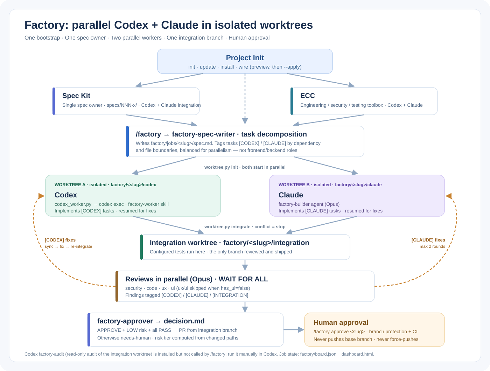

# Project Init factory stack



This is the recommended factory profile for projects that use both Claude Code and Codex.

## Ownership

```text
Project Init
  ├─ inspects a new/existing repo
  ├─ installs one spec methodology
  ├─ installs ECC for both coding harnesses
  └─ installs/validates the Factory wiring

Spec Kit (default)
  └─ owns requirements -> spec -> plan -> tasks in specs/NNN-x/

Factory
  ├─ converts approved Spec Kit work into an execution contract
  ├─ splits independent work units by dependency/file boundaries
  ├─ runs Codex and Claude concurrently in separate Git worktrees
  ├─ integrates both branches in a third integration worktree
  ├─ runs security/code/UX/UI review rounds on the integrated result
  └─ stops for conflicts, high risk, failed review, or human approval

Codex / Claude
  └─ general implementation workers; neither owns frontend or backend

ECC
  └─ reusable engineering/security/review capabilities for both workers
```

## Why Spec Kit is the default

The factory already has a native entry point for `specs/NNN-x/`, and current Spec Kit integrations install skills into both `.agents/skills/` for Codex and `.claude/skills/` for Claude. This gives both coding agents the same spec source without creating a second planning system.

BMAD remains supported by Project Init, but it is intentionally **not** installed alongside Spec Kit for the same project workflow. Use BMAD instead when the project needs its broader product discovery, UX and architecture process and you are willing to let BMAD become the one spec owner.

## Bootstrap

The normal workflow has one entry point:

```powershell
cd C:\Work\App

# Inspect/resume and preview the complete Factory bootstrap.
project-init init --project .

# Apply the same bootstrap.
project-init init --project . --apply
```

Project Init owns the sequence: detect New/Existing → ensure Git when needed → install Spec Kit for both agents → install ECC for both agents → install/update the bundled Factory.

Factory includes the reviewed orchestrator, worktree manager, generic Claude worker/review agents, Codex worker bridge, dashboard/backlog templates, and:

- `.agents/skills/factory-worker/SKILL.md`
- `.agents/skills/factory-audit/SKILL.md`

Existing `factory/backlog.md` is preserved. Legacy Factory config is migrated to the parallel-worktree schema while retaining user settings such as test commands. Runtime job/worktree state is ignored from Git. The lower-level component commands remain available for debugging or custom setups, but are not the normal Factory bootstrap.

## Normal workflow

1. Use either Claude or Codex with Spec Kit to create/refine the approved feature specification.
2. Keep the approved source of truth in `specs/NNN-x/`.
3. Run Claude's `/factory spec specs/NNN-x` orchestration.
4. Factory writes an execution contract that assigns independent tasks to `[CODEX]` and `[CLAUDE]` based on file/dependency boundaries—not frontend/backend categories.
5. Factory creates three isolated worktrees from the same committed base: Codex, Claude, and integration.
6. Codex and Claude implement their work units in parallel.
7. Factory merges both worker branches into the integration worktree. Merge conflicts stop the run instead of allowing one worker to overwrite the other.
8. Tests and reviewers inspect the integrated result. Findings route back to the worker that owns the affected task/file.
9. Passing low-risk work reaches the human approval/release gate.

## Parallelism and isolation

```text
                 Factory job
                     |
          +----------+----------+
          |                     |
   Codex worktree          Claude worktree
   any assigned work       any assigned work
          |                     |
          +----------+----------+
                     |
             integration worktree
                     |
              tests + reviewers
                     |
               human approval
```

**One worker = one worktree.** Worker tags are per-job ownership labels. They must never be interpreted as stack ownership.

## Boundaries

- Project Init does not duplicate the Spec Kit PRD/spec/plan/tasks.
- ECC does not own requirements or task status.
- Workers do not edit each other's assigned files or Factory orchestration state.
- API/data/interface contracts in a Factory job are binding for both workers.
- Factory runtime job files are evidence/state, not a second product backlog.
